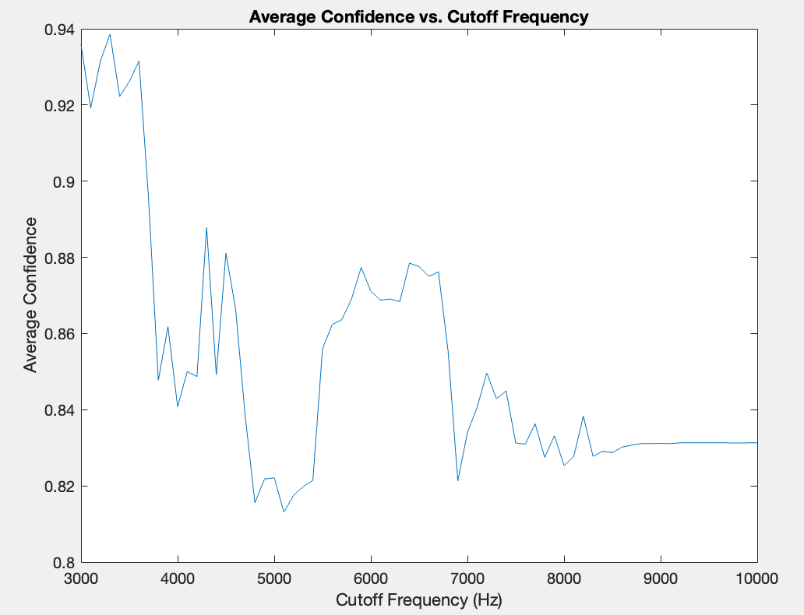
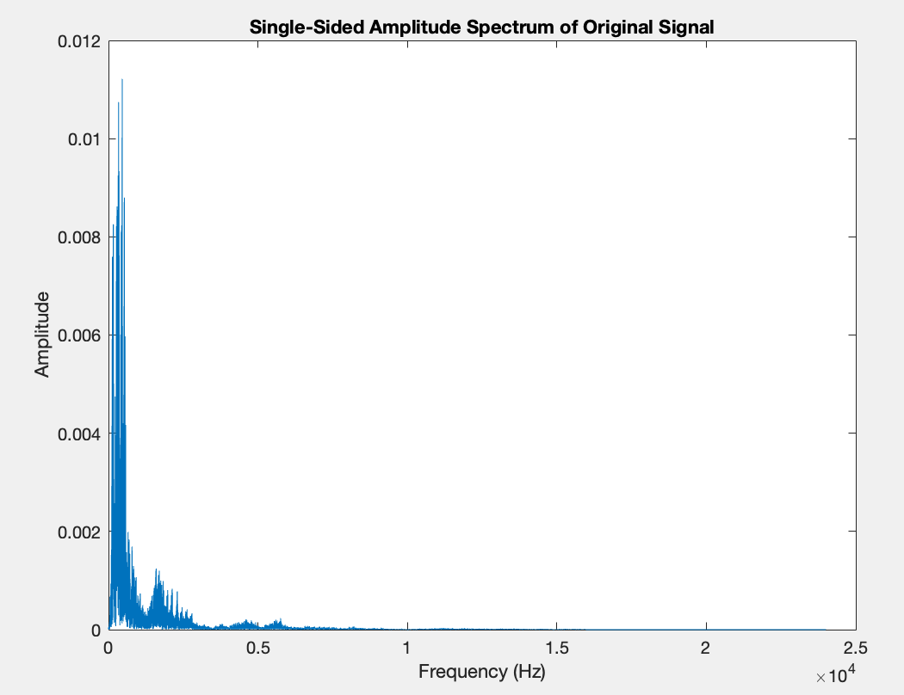
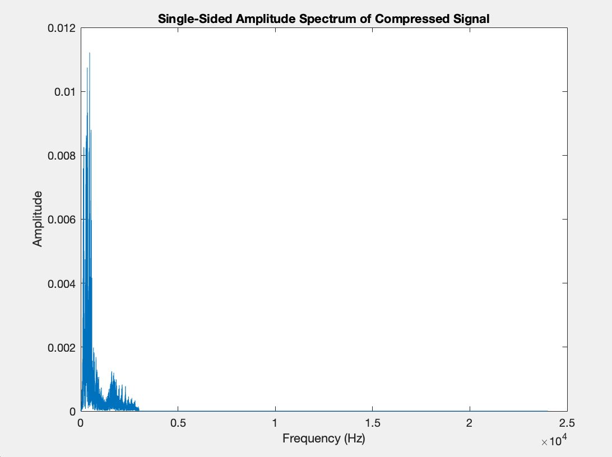

# Audio Compression vs. Speech Recognition (EE 202)

Solo project for EE 202, Introduction to Electrical Engineering, at
Northwestern University. How much of a speech recording's spectrum can be
thrown away before a speech-to-text model stops understanding it?

## Method

`compression_algorithm/deep_dive.m` (MATLAB):

1. Load a speech clip and transcribe it with a pretrained wav2vec 2.0 model
   to get a baseline transcript.
2. Take the FFT and zero every bin above a cutoff frequency, keeping
   conjugate symmetry so the inverse FFT is real.
3. Inverse FFT, normalize, and transcribe the compressed audio.
4. Lower the cutoff from 10 kHz in 100 Hz steps, recording the model's mean
   word confidence, until the transcript no longer matches the baseline.
5. Report the cutoff where recognition fails and the fraction of frequency
   bins kept, and plot confidence against cutoff plus the original and
   compressed spectra.

## Results

Recognition survived cutting the spectrum down to about 3 kHz, where the
transcript first diverged from the baseline. Mean word confidence rose as high
frequencies were removed: about 0.83 with the full band, a low of 0.81 near
5 kHz, and about 0.93 between 3.0 and 3.6 kHz.

| Plot | File |
|---|---|
| Confidence vs. cutoff |  |
| Original spectrum |  |
| Compressed spectrum |  |

## Notes

This is spectral truncation (an ideal low-pass filter), not a codec: nothing
is re-encoded, so the "compression ratio" is the share of frequency bins kept.
Requires MATLAB with Audio Toolbox and the wav2vec 2.0 support files.

## Stack

MATLAB, FFT, wav2vec 2.0 speech-to-text
